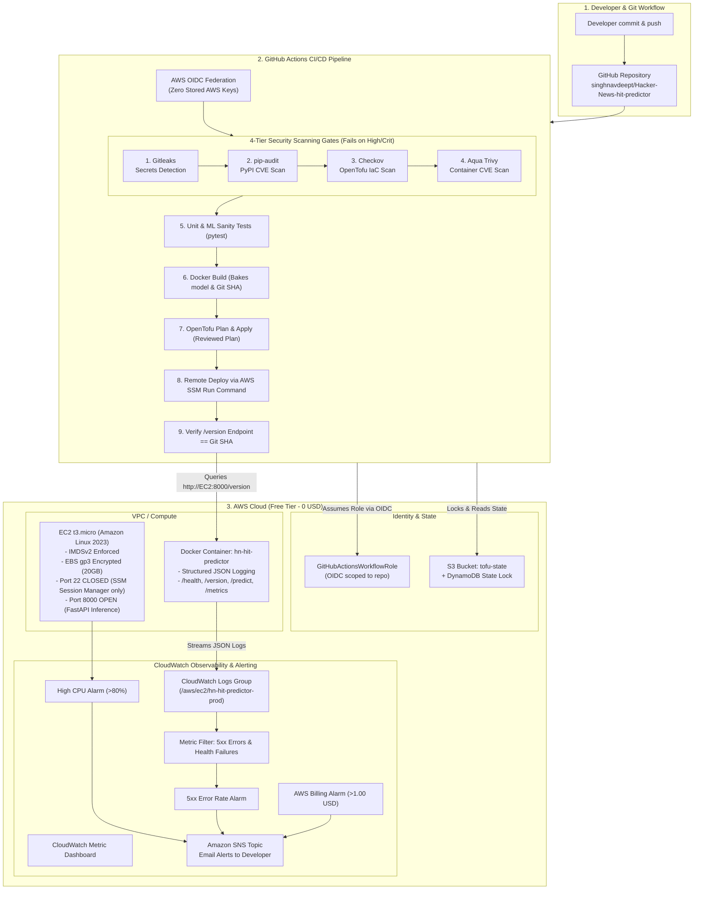

# HN HIT Predictor: Production MLOps & DevSecOps Platform on AWS

[](https://github.com/singhnavdeept/Hacker-News-hit-predictor/actions/workflows/ci-cd.yml)
[](https://opentofu.org)
[](https://docs.github.com/en/actions/deployment/security-hardening-your-deployments/about-security-hardening-with-openid-connect)
[]()
[-brightgreen.svg)]()

**HN HIT Predictor** is an enterprise-grade Machine Learning Operations (MLOps) and DevSecOps platform that predicts whether a Hacker News submission will reach the front page (50+ points).

Built to industry standards matching production engineering requirements:
* **Infrastructure as Code (IaC):** Modular **OpenTofu** with remote S3 backend, DynamoDB state locking, and separate `staging` / `prod` environments.
* **CI/CD with Zero Stored AWS Keys:** **GitHub Actions** authenticates to AWS via **OIDC (OpenID Connect)** federation.
* **4-Tier Shift-Left DevSecOps:** Automated scans for secrets (**Gitleaks**), Python dependencies (**pip-audit**), IaC misconfigurations (**Checkov**), and container vulnerabilities (**Aqua Trivy**) that fail on high-severity findings.
* **Deploy Verification & Fast Rollback:** Automated verification asserting the live `/version` Git SHA matches release, paired with a 1-click rollback workflow.
* **SRE Observability:** Structured JSON logs to CloudWatch, custom metric filters, high CPU / 5xx error alarms, AWS billing alarms, and SNS email notifications.
* **Zero-SSH Attack Surface:** Port 22 closed; host access strictly via **AWS Systems Manager (SSM) Session Manager** with **IMDSv2 enforced** and **encrypted gp3 EBS volumes**.

---

## 🏗️ End-to-End System Architecture



---

## 🔒 Security Posture & DevSecOps Compliance

| Security Dimension | Implementation | Standard / Benefit |
|---|---|---|
| **Cloud Authentication** | AWS IAM OIDC Provider | Zero static access keys; short-lived STS tokens |
| **Host Access** | AWS Systems Manager (SSM) | Port 22 (SSH) is completely closed to the internet |
| **Metadata Protection** | IMDSv2 Strictly Enforced | Mitigates Server-Side Request Forgery (SSRF) credential theft |
| **Data at Rest** | AES-256 (S3) & KMS/AES (EBS gp3) | Full disk and object storage encryption |
| **Secrets in Code** | Gitleaks in CI | Blocks commits containing API keys, AWS tokens, or passwords |
| **Dependency Security** | `pip-audit` in CI | Halts builds if Python dependencies have published CVEs |
| **IaC Compliance** | Checkov in CI | Validates OpenTofu against CIS AWS Foundations Benchmark |
| **Image Hardening** | Aqua Trivy in CI | Scans container layers and fails on unfixed High/Critical CVEs |

---

## 🚀 API Endpoints

Once deployed on EC2 (or run locally on port 8000):

* **Web UI Dashboard:** `GET /` — Interactive dark-themed Hacker News UI.
* **Health Check:** `GET /health` — Liveness & readiness probe.
* **Deployment Verification:** `GET /version` — Returns active Git commit SHA, environment, and build metadata.
* **Real-Time Prediction:** `POST /predict` — Analyzes submission title, domain category, and timing.
* **Operational Metrics:** `GET /metrics` — Precision, recall, F1, and AUC statistics.
* **Interactive Swagger UI:** `GET /docs` — Live API documentation and testing interface.

### Sample Prediction Request:
```bash
curl -X POST http://<EC2_IP>:8000/predict \
  -H "Content-Type: application/json" \
  -d '{
    "title": "Show HN: FastKV – High Performance Key-Value Store in Rust",
    "url": "https://github.com/developer/fastkv",
    "submission_time": "2026-11-22T15:30:00Z"
  }'
```

### Sample Prediction Response:
```json
{
  "title": "Show HN: FastKV – High Performance Key-Value Store in Rust",
  "is_hit": true,
  "hit_probability": 0.8421,
  "confidence_level": "High",
  "prediction_label": "Likely Hit (Frontpage Material)",
  "features": {
    "title": "Show HN: FastKV – High Performance Key-Value Store in Rust",
    "domain_type": "github",
    "submission_hour": 15,
    "submission_day": 6,
    "title_len": 58,
    "title_word_count": 9
  }
}
```

---

## 🛠️ Infrastructure Management with OpenTofu

### 1. One-Time Bootstrap (State Bucket & DynamoDB Lock)
```bash
cd tofu/bootstrap
tofu init
tofu plan -out=tfplan
tofu apply tfplan
```

### 2. Deploy Staging or Production
```bash
cd tofu/environments/prod
tofu init
tofu plan -out=tfplan
tofu apply tfplan
```

### 3. Clean Teardown (Zero Cost After Testing)
```bash
cd tofu/environments/prod
tofu destroy -auto-approve

cd ../../bootstrap
tofu destroy -auto-approve
```

---

## 📚 Complete Project Documentation

* 📖 **[Operational Runbook](docs/OPERATIONAL_RUNBOOK.md):** Step-by-step incident response, alarm troubleshooting, and 1-click rollback guide.
* 📋 **[Production Upgrade Plan](docs/PRODUCTION_UPGRADE_PLAN.md):** Full JD alignment, cost analysis, and architectural design specification.
* 🎓 **[Viva & Technical Question Bank](docs/VIVA_QUESTIONS.md):** 100 comprehensive questions covering MLOps, Docker, AWS, OpenTofu, and DevSecOps.
* 📘 **[Complete Learning Guide](docs/LEARNING_GUIDE.md):** In-depth technical reference explaining every architectural decision and component.
