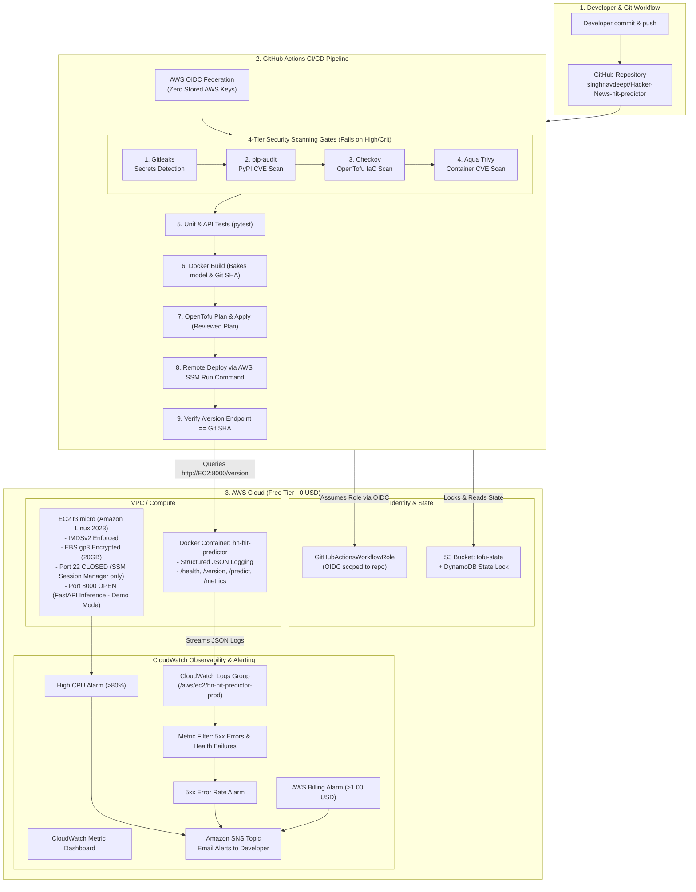

# HN HIT Predictor: MLOps & DevSecOps Platform on AWS Free Tier

[](https://github.com/singhnavdeept/Hacker-News-hit-predictor/actions/workflows/ci-cd.yml)
[](https://opentofu.org)
[](https://docs.github.com/en/actions/deployment/security-hardening-your-deployments/about-security-hardening-with-openid-connect)
[]()
[-brightgreen.svg)]()

**HN HIT Predictor** is a production-style Machine Learning Operations (MLOps) and DevSecOps platform on AWS that predicts whether a Hacker News submission will reach the front page (50+ points).

Built to demonstrate modern cloud engineering, shift-left security, and infrastructure best practices:
* **Infrastructure as Code (IaC):** Modular **OpenTofu** with remote S3 backend, DynamoDB state locking, and separate `staging` / `prod` environments.
* **CI/CD with Zero Stored AWS Keys:** **GitHub Actions** authenticates to AWS via **OIDC (OpenID Connect)** federation using short-lived STS tokens.
* **4-Tier Shift-Left DevSecOps:** Automated gates for secrets (**Gitleaks**), Python dependencies (**pip-audit**), IaC misconfigurations against CIS AWS checks (**Checkov**), and container vulnerabilities (**Aqua Trivy**) that fail on high-severity findings.
* **Deploy Verification & Fast Rollback:** Automated release verification asserting the live `/version` Git SHA matches release, paired with a 1-click rollback workflow dispatch.
* **CloudWatch Observability:** Structured JSON application logging with request duration, custom metric filters for 5xx errors and health check failures, high CPU alarm, AWS billing alarm, and SNS alerts.
* **Zero-SSH Attack Surface:** Port 22 is closed; host access is strictly via **AWS Systems Manager (SSM) Session Manager** with **IMDSv2 enforced** and **encrypted gp3 EBS volumes**.

---

## 🏗️ End-to-End System Architecture



---

## 🔒 Security Posture & DevSecOps Controls

| Security Dimension | Implementation | Standard / Benefit |
|---|---|---|
| **Cloud Authentication** | AWS IAM OIDC Provider | Zero static access keys; short-lived STS tokens |
| **Host Administration** | AWS Systems Manager (SSM) | Port 22 (SSH) is completely closed to the internet |
| **Metadata Protection** | IMDSv2 Strictly Enforced | Mitigates Server-Side Request Forgery (SSRF) credential theft |
| **Data at Rest** | AES-256 (S3) & KMS/AES (EBS gp3) | Full disk and object storage encryption |
| **Secrets in Code** | Gitleaks in CI | Blocks commits containing API keys, AWS tokens, or passwords |
| **Dependency Security** | `pip-audit` in CI | Halts builds if Python dependencies have published CVEs |
| **IaC Security Checks** | Checkov in CI | Scans OpenTofu against CIS AWS Foundations Benchmark checks |
| **Image Hardening** | Aqua Trivy in CI | Scans container layers and fails on unfixed High/Critical CVEs |

---

## 🌐 Network Architecture & Free Tier Trade-Offs

* **Port 8000 & TLS Context:**
  * In this demo environment, port 8000 serves HTTP directly on the EC2 instance to operate strictly within the **AWS Free Tier ($0.00/month)**.
  * In a funded production environment, the EC2 instance resides in a private subnet with no public IP, placed behind an **AWS Application Load Balancer (ALB)** with ACM-managed TLS termination (HTTPS port 443) and AWS WAF. Under Free Tier, ALBs cost ~$16–$22/month and require custom domain DNS, so direct ingress is permitted on port 8000 and documented with Checkov suppression rationale (`CKV_AWS_260`).

---

## 🚀 API Endpoints

Once deployed on EC2 (or run locally on port 8000):

* **Web UI Dashboard:** `GET /` — Interactive dark-themed Hacker News submission tester.
* **Health Check:** `GET /health` — Liveness & readiness probe.
* **Deployment Verification:** `GET /version` — Returns active Git commit SHA, environment, and build timestamp.
* **Real-Time Prediction:** `POST /predict` — Analyzes submission title, domain category, and timing.
* **Model Evaluation Metrics:** `GET /metrics` — Validation dataset precision, recall, F1, and ROC-AUC statistics.
* **Interactive Swagger UI:** `GET /docs` — OpenAPI documentation and interactive testing sandbox.

### Sample Prediction Request:
```bash
curl -X POST http://<EC2_IP>:8000/predict \
  -H "Content-Type: application/json" \
  -d '{
    "title": "Show HN: FastKV – High Performance Key-Value Store in Rust",
    "url": "https://github.com/developer/fastkv",
    "submission_time": "2026-11-22T15:30:00Z"
  }'
```

### Sample Prediction Response:
```json
{
  "title": "Show HN: FastKV – High Performance Key-Value Store in Rust",
  "is_hit": true,
  "hit_probability": 0.8421,
  "confidence_level": "High",
  "prediction_label": "Likely Hit (Frontpage Material)",
  "features": {
    "title": "Show HN: FastKV – High Performance Key-Value Store in Rust",
    "domain_type": "github",
    "submission_hour": 15,
    "submission_day": 6,
    "title_len": 58,
    "title_word_count": 9
  }
}
```

---

## 🛠️ Infrastructure Management with OpenTofu

### 1. One-Time Bootstrap (State Bucket & DynamoDB Lock Table)
```bash
cd tofu/bootstrap
tofu init
tofu plan -out=tfplan
tofu apply tfplan
```

### 2. Deploy Staging or Production
```bash
cd tofu/environments/prod
tofu init -backend-config="bucket=<YOUR_STATE_BUCKET>"
tofu plan -out=tfplan
tofu apply tfplan
```

### 3. Clean Teardown (Zero Cost After Testing)
```bash
cd tofu/environments/prod
tofu destroy -auto-approve

cd ../../bootstrap
tofu destroy -auto-approve
```

---

## 📦 Architecture Evolution (v1 to v2)

The `archive/` folder preserves legacy v1 components:
* **`archive/cloudformation/`**: Initial monolithic AWS template. Replaced by modular OpenTofu with remote state locking and environment separation.
* **`archive/Jenkinsfile`**: Early on-host CI/CD pipeline. Decommissioned to free ~1 GB RAM on EC2 and eliminate static SSH key exposure, replaced by GitHub Actions with AWS OIDC federation.

---

## 📚 Engineering Documentation

* 📖 **[Operational Runbook](docs/OPERATIONAL_RUNBOOK.md):** Step-by-step incident triage, CloudWatch alarm procedures, and 1-click rollback guide.
* 🛠️ **[Incident, Bug & Fix Log](docs/INCIDENT_AND_FIX_LOG.md):** Technical root-cause analyses (RCAs) and permanent fixes for 9 pipeline, dependency, and infrastructure issues encountered during development.
