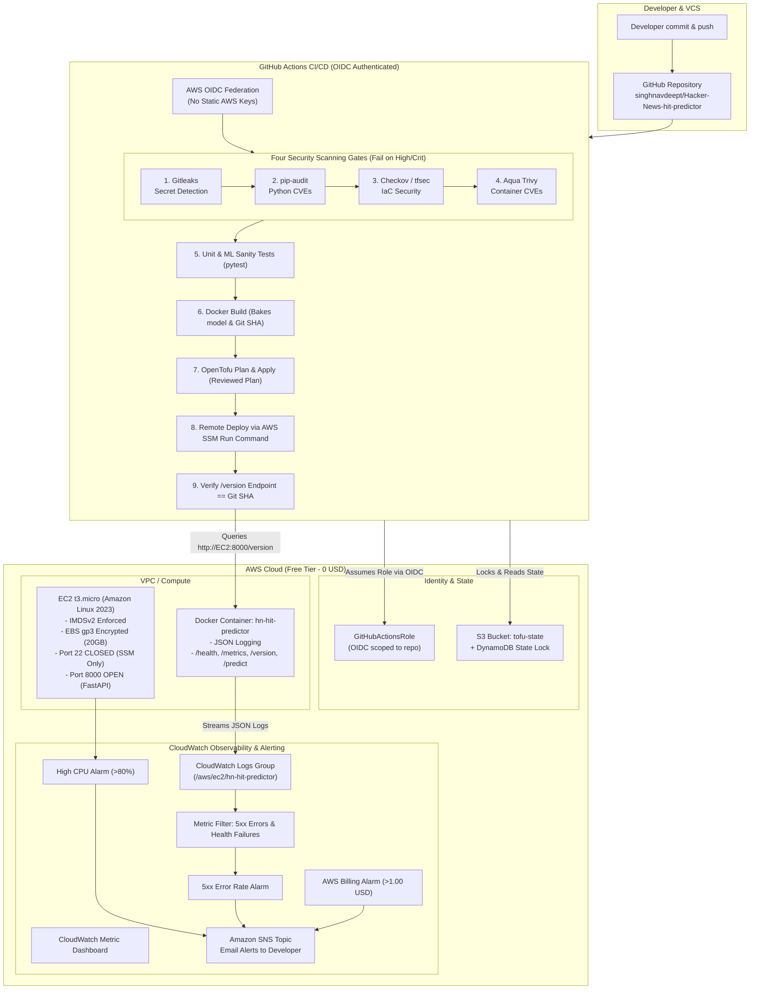
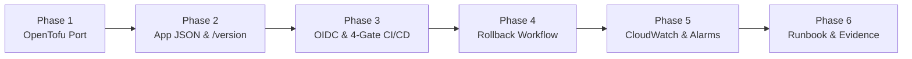

# 🚀 HN Hit Predictor — Production MLOps/DevOps Upgrade Plan

> **Objective:** Transition the existing AWS/Docker/Jenkins stack into an industry-grade, enterprise-ready DevOps & MLOps implementation matching top-tier Job Description expectations, with zero cloud cost overruns (AWS Free Tier compliant).

---

## 📋 Executive Overview & Gap Analysis

| Category | Current State | Target State (This Plan) | JD Impact |
|---|---|---|---|
| **IaC** | AWS CloudFormation (`infra.yaml`) | **OpenTofu** modular structure (`staging` & `prod`), remote S3 backend + DynamoDB locking | High (OpenTofu/Terraform standard) |
| **CI/CD & Auth** | Local Jenkins container on EC2, manual triggers | **GitHub Actions** with **AWS OIDC federation** (zero stored access keys) | Critical (OIDC security standard) |
| **Compute Load** | Jenkins + API sharing 1 GB t3.micro RAM | Jenkins retired; 100% of t3.micro RAM dedicated to FastAPI inference | Critical (Solves OOM crashes permanently) |
| **DevSecOps** | Checkov + Trivy in Jenkins (soft-fail) | **4 Automated Gates (Hard-fail on High/Crit):**<br>1. Secrets (`gitleaks`)<br>2. Dependencies (`pip-audit`)<br>3. IaC (`checkov`/`tfsec`)<br>4. Containers (`trivy`) | High (Shift-Left DevSecOps) |
| **Verification & Rollback** | Basic curl check, manual recovery | Automated `/version` check against Git SHA post-deploy + **1-click GitHub Actions rollback workflow** | High ("Confirm every deploy actually rolls out") |
| **Observability** | Basic EC2 metrics, unformatted text logs | **Structured JSON logs** to CloudWatch + Metric filters for 5xx/health + CloudWatch Dashboard + **SNS Email Alarms** + Billing Alarm | High (SRE & Observability) |
| **Host Security** | Port 22 SSH open to CIDR, IMDSv1 | **Zero open SSH ports** (SSM Session Manager only), **IMDSv2 enforced**, encrypted EBS gp3 | High (CIS Benchmark compliance) |

---

## 🏗️ Target Architecture Diagram



---

## 📅 Step-by-Step Implementation Roadmap



---

### Phase 1: OpenTofu Infrastructure Port (Cost: $0)
* **Goal:** Replace `cloudformation/infra.yaml` with a production-grade, modular OpenTofu configuration with remote state.
* **Directory Structure to Create:**
  ```text
  tofu/
  ├── backend/
  │   └── s3-backend-bootstrap.yaml   # Creates S3 bucket & DynamoDB table for state (run once)
  ├── modules/
  │   └── app_stack/
  │       ├── main.tf                 # EC2, Security Group, IAM Role, Instance Profile
  │       ├── variables.tf            # Parameterized inputs (instance_type, env, disk_size)
  │       ├── outputs.tf              # Public IP, instance ID, URLs
  │       └── userdata.sh             # Docker install, CloudWatch agent, SSM agent setup
  └── environments/
      ├── staging/
      │   ├── main.tf                 # Calls module app_stack
      │   ├── backend.tf              # S3 backend key: envs/staging/tofu.tfstate
      │   ├── variables.tf
      │   └── terraform.tfvars        # staging values
      └── prod/
          ├── main.tf                 # Calls module app_stack
          ├── backend.tf              # S3 backend key: envs/prod/tofu.tfstate
          ├── variables.tf
          └── terraform.tfvars        # prod values
  ```
* **Key Security Attributes in OpenTofu:**
  - `http_tokens = "required"` & `http_put_response_hop_limit = 1` (IMDSv2 enforced).
  - `root_block_device { encrypted = true, volume_type = "gp3", volume_size = 20 }`.
  - Ingress: Port 8000 open to `0.0.0.0/0`, Port 22 **removed** (SSM Session Manager used instead).

---

### Phase 2: Application Enhancements (/version & Structured JSON Logging)
* **Goal:** Equip FastAPI with deployment verification and CloudWatch-parseable logging.
* **Files to Modify:**
  1. `app/schemas.py`:
     - Add `VersionResponse` schema:
       ```python
       class VersionResponse(BaseModel):
           service: str
           version: str
           git_sha: str
           environment: str
           model_loaded: bool
           timestamp: str
       ```
  2. `app/main.py`:
     - Read `GIT_COMMIT` and `APP_ENV` from environment variables (injected during Docker build).
     - Implement `GET /version` returning the commit SHA and build metadata.
     - Implement custom JSON formatter for Python `logging`:
       ```json
       {"timestamp": "2026-11-22T17:00:00Z", "level": "INFO", "service": "hn-hit-predictor", "method": "POST", "path": "/predict", "status": 200, "latency_ms": 1.45, "message": "Prediction made for 'Show HN: ...'"}
       ```
  3. `docker/Dockerfile`:
     - Accept build argument `ARG GIT_COMMIT=unknown` and expose `ENV GIT_COMMIT=${GIT_COMMIT}`.

---

### Phase 3: GitHub Actions CI/CD with AWS OIDC & 4 Scanning Gates
* **Goal:** Eliminate static AWS credentials (`AWS_ACCESS_KEY_ID` / `AWS_SECRET_ACCESS_KEY`) and implement a 4-tier security gate.
* **AWS OIDC Setup:**
  - Create AWS IAM OpenID Connect Provider for `token.actions.githubusercontent.com`.
  - Create IAM Role `GitHubActionsWorkflowRole` with trust policy scoped strictly to:
    ```json
    "StringEquals": {
      "token.actions.githubusercontent.com:aud": "sts.amazonaws.com"
    },
    "StringLike": {
      "token.actions.githubusercontent.com:sub": "repo:singhnavdeept/Hacker-News-hit-predictor:*"
    }
    ```
* **Workflow File:** `.github/workflows/ci-cd.yml`
  - **Job 1: Security & Quality Gates (Parallel/Staged)**
    - 🔒 **Secrets:** `gitleaks detect --source . --verbose` (Fails if secrets/tokens found).
    - 🐍 **Dependencies:** `pip-audit -r requirements.txt` (Fails on known Python CVEs).
    - 📄 **IaC:** `checkov -d tofu/ --framework terraform` (Fails on HIGH/CRITICAL AWS misconfigurations).
    - 🧪 **Unit Tests:** `pytest -v tests/`.
  - **Job 2: Docker Build & Container Scan**
    - Build image with `--build-arg GIT_COMMIT=${{ github.sha }}`.
    - 🐳 **Container Scan:** `aquasec/trivy-action` scanning image with `--severity HIGH,CRITICAL --exit-code 1 --ignore-unfixed`.
  - **Job 3: OpenTofu Plan & Apply**
    - Authenticate via `aws-actions/configure-aws-credentials@v4` with role ARN.
    - Run `tofu plan -no-color -out=tfplan` and attach plan summary to PR/run.
    - On merge to `main`, run `tofu apply tfplan`.
  - **Job 4: Continuous Deployment & Verification**
    - Deploy image to EC2 via AWS SSM Run Command (or SSH over SSM tunnel).
    - Poll `http://<EC2_IP>:8000/version` using `curl` and jq.
    - Assert `git_sha == "${{ github.sha }}"`. If it fails or times out within 60s, fail the build immediately.

---

### Phase 4: Deploy Verification & Fast Rollback Workflow
* **Goal:** Guarantee zero downtime and instant recovery if a bad model or bug passes through.
* **Workflow File:** `.github/workflows/rollback.yml`
  - Trigger: `workflow_dispatch` with input parameter `target_image_tag` or `target_git_sha` (defaults to previous release).
  - Execution:
    1. Authenticate via AWS OIDC.
    2. Execute SSM Run Command on EC2:
       ```bash
       docker stop hn-hit-predictor-api || true
       docker rm hn-hit-predictor-api || true
       docker run -d --name hn-hit-predictor-api --restart unless-stopped -p 8000:8000 hn-hit-predictor:${TARGET_TAG}
       ```
    3. Run automated verification against `http://<EC2_IP>:8000/version` confirming previous tag is live.
    4. Post confirmation message to workflow run summary.

---

### Phase 5: CloudWatch Observability, Alarms & Cost Guardrails
* **Goal:** Real-time visibility into infrastructure health, error rates, and billing.
* **CloudWatch Metric Filters (defined in OpenTofu):**
  - **Metric 1: 5xx Server Errors** — pattern `{ $.status >= 500 }`.
  - **Metric 2: Health Check Failures** — pattern `{ $.path = "/health" && $.status != 200 }`.
* **CloudWatch Alarms (defined in OpenTofu):**
  1. `HighCPUUtilization`: CPU > 80% for 2 consecutive 5-min periods.
  2. `Api5xxErrorRate`: > 5 errors in a 5-minute window.
  3. `HealthCheckFailed`: Health check failure > 1 in 1 minute.
  4. `MonthlyBillingAlarm`: Estimated charges > $1.00 USD (in `us-east-1`).
* **Amazon SNS Topic:** `hn-hit-predictor-alerts` sending email to developer on alarm transition.
* **CloudWatch Dashboard:**
  - One consolidated dashboard with 4 widgets:
    - Widget 1: CPU & Memory Utilization.
    - Widget 2: Total Request Count & Latency Percentiles (p50, p95).
    - Widget 3: 5xx Error Count.
    - Widget 4: Prediction Hit vs Non-Hit distribution.

---

### Phase 6: Operational Runbook, Architecture Diagram & Evidence
* **Goal:** Documentation that directly satisfies the reviewer's evaluation criteria.
* **Artifacts to Deliver:**
  1. `docs/OPERATIONAL_RUNBOOK.md`:
     - Incident response procedures for:
       - `HighCPUUtilization` alarm.
       - `Api5xxErrorRate` alarm.
       - `HealthCheckFailed` alarm.
       - Fast rollback step-by-step instructions.
       - Disaster recovery & cold-start deployment from OpenTofu.
  2. `README.md` revamp:
     - Clear ASCII / Mermaid architecture diagrams.
     - Security posture summary (OIDC, SSM, IMDSv2, 4-tier scanning).
     - Commands to plan, apply, deploy, and destroy.
  3. `docs/EVIDENCE.md`:
     - Screenshot placeholders / instructions for:
       - GitHub Actions 4-tier scan passing.
       - OpenTofu plan/apply output.
       - CloudWatch dashboard & alarm test.
       - `/version` endpoint live response.

---

## 💰 Cost & Free Tier Guardrails Checklist

| Resource | Free Tier Allowance | Our Design | Projected Cost |
|---|---|---|---|
| **EC2** | 750 hrs/month of t3.micro | 1x `t3.micro` | **$0.00** |
| **EBS Storage** | 30 GB/month gp3 | 20 GB gp3 encrypted | **$0.00** |
| **S3 Storage** | 5 GB standard | Remote state + artifacts (< 100 MB) | **$0.00** |
| **DynamoDB** | 25 GB / 25 RCU/WCU | Lock table: 1 RCU / 1 WCU | **$0.00** |
| **CloudWatch Alarms** | 10 free alarms | 4 alarms configured | **$0.00** |
| **CloudWatch Metrics** | 10 custom metrics | 2 custom metric filters | **$0.00** |
| **CloudWatch Dashboard** | 3 free dashboards | 1 dashboard | **$0.00** |
| **CloudWatch Logs** | 5 GB ingestion/month | Retention set to 7 days (~50 MB) | **$0.00** |
| **Secrets Manager vs SSM** | Secrets Manager costs $0.40/secret | **SSM Parameter Store** (Standard Tier is **FREE**) | **$0.00** |
| **Public IPv4** | New AWS rule charges $0.005/hr | Kept within active test window; tear down with `tofu destroy` | **<$1.00** |

---

## 🎯 Verification & Acceptance Criteria

- [ ] `tofu plan` runs cleanly for both `staging` and `prod`.
- [ ] GitHub Actions workflow triggers on push to `main` with zero stored AWS keys.
- [ ] Gitleaks, pip-audit, Checkov, and Trivy run in CI and block pipeline on critical vulnerabilities.
- [ ] Visiting `http://<EC2_IP>:8000/version` returns the active Git commit SHA.
- [ ] Running `.github/workflows/rollback.yml` reverts the live container to a previous tag and validates `/version`.
- [ ] Logs in CloudWatch Logs show formatted JSON with request latency and status codes.
- [ ] Triggering an alarm sends an email notification via SNS.
- [ ] `tofu destroy` successfully removes all cloud resources cleanly.
